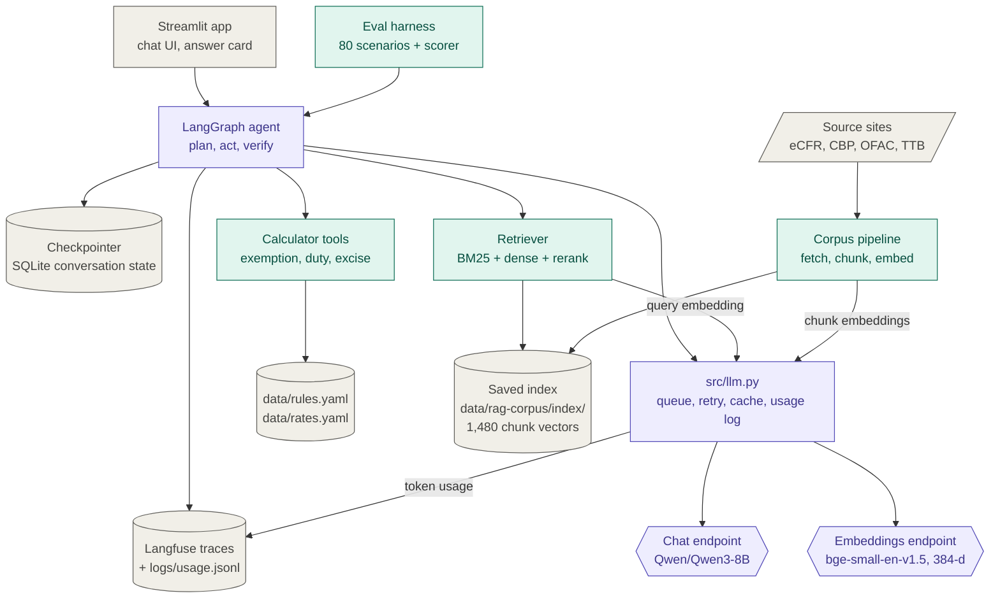
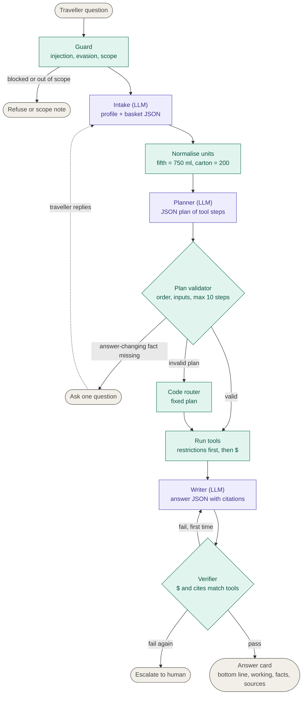

# Architecture

How DeclareRight is put together. The diagrams are Mermaid: GitHub and VS Code render them, and they read as plain text for anyone (or any Claude session) opening the repo. The rules every component must follow are in `CLAUDE.md`.

## 1. Components

The model reads the question and writes the answer. Everything that decides the answer (restrictions, exemptions, dollar amounts) is plain code.

Purple = uses the LLM · green = plain code · grey = data, UI, logs.

| Component | Where | Kind | Job |
| --- | --- | --- | --- |
| Streamlit app | `app/streamlit_app.py` | UI | Traveller chat; shows bottom line, working, facts relied on, sources |
| Eval harness | `eval/` | Code | Runs the 80 `eval-v1` scenarios through the agent; `score.py` scores deterministically |
| LangGraph agent | `src/agent/graph.py` | LLM + code | Runs the request flow below |
| Checkpointer | SQLite via LangGraph `SqliteSaver` | Data | Keeps conversation state so a correction re-runs only the affected steps |
| Calculator tools | `src/tools/` | Code | `normalise_units`, `check_restrictions`, `determine_exemption`, `compute_allowance`, `compute_duty_excise`, `lookup_state_rule`, `whatif_optimise`, `escalate_to_human` |
| Rules + rates | `data/rules.yaml`, `data/rates.yaml` | Data | Allowances, limits, prohibited origins, TTB excise rates; every row has a citation and as-of date |
| Retriever | `src/retrieval/`, `src/tools/search_regulations.py` | Code | `search_regulations`: clauses for the rules the tools applied (by citation id), then hybrid search (hard negatives filtered first, BM25 + dense, RRF k=60, `bge-reranker-v2-m3` on the top 30) fills up to 5 chunks. Decisions: `docs/RETRIEVAL.md` |
| Saved index | `data/rag-corpus/index/` (git-ignored) | Data | `vectors.npy` (one normalised 384-d vector per 350-token chunk) + `meta.json` (model, fingerprint of the chunk set). Searched in numpy (~1 ms); no vector database at this size (`docs/RETRIEVAL.md`, decision 3) |
| `src/llm.py` | `src/llm.py` | Code | The only way to call a model: one request in flight per endpoint, back-off on 429/5xx, response cache, writes `logs/usage.jsonl` |
| Chat endpoint | upGrad, own URL / key / CA cert | External | `Qwen/Qwen3-8B`: native tool calls and `json_schema` supported; 8,192 tokens per call, 1,024 max output |
| Embeddings endpoint | upGrad, own URL / key / CA cert | External | `bge-small-en-v1.5`, 384 dimensions, max 512 tokens per input; no `/models` route |
| Corpus pipeline | `data/rag-corpus/` | Code | Fetches official sources and chunks them (`chunk_corpus.py`); `python -m src.retrieval.index` embeds the chunks into the saved index; snapshot frozen Day 3 |
| Langfuse | Docker service | Logs | One trace per question: every step's input, output, tokens, latency. Used for debugging and failure labelling |

## 2. Request flow for one question

Step by step:

1. **Guard (code).** Blocks prompt injection and requests to evade customs; out-of-scope goods get a short scope note.
2. **Intake (LLM).** Extracts the traveller profile (age, trip hours, exemption used in last 30 days, countries, arrival state) and the basket (item, quantity, unit, ABV, value, origin, where bought) as JSON.
3. **Normalise units (code).** "a fifth" → 750 ml, "carton" → 200 cigarettes, "box of 25" → 25 cigars; ABV → proof.
4. **Planner (LLM).** Proposes the tool steps as a JSON plan.
5. **Plan validator (code).** Checks allowed order (restrictions before any calculation), required inputs, at most 10 steps. Missing answer-changing fact → one clarifying question. Invalid plan → the fixed code router plan.
6. **Run tools (code).** `check_restrictions` → `determine_exemption` → `compute_allowance` → `compute_duty_excise` → `lookup_state_rule` → `search_regulations`.
7. **Writer (LLM).** Bottom line, working, facts relied on, citations (only retrieved clause ids), as-of date, disclaimer.
8. **Verifier (code + one LLM check).** Every dollar figure must equal a tool output; every citation must be in the retrieved set; facts must match the profile; no evasion advice. One writer retry, then escalate.

A clarifying question ends the turn. The reply re-enters at intake, and the checkpointer keeps earlier facts, so only steps that depend on the new fact run again.

## 3. Ablations run against this design

| Variant | What changes | Why |
| --- | --- | --- |
| `agent` | Full flow above | System under test |
| `code_router` | Planner replaced by the fixed plan | Is the LLM planner worth it? |
| `single_rag` | Retrieve + one LLM answer, no tools or verifier | Baseline for the whole design |
