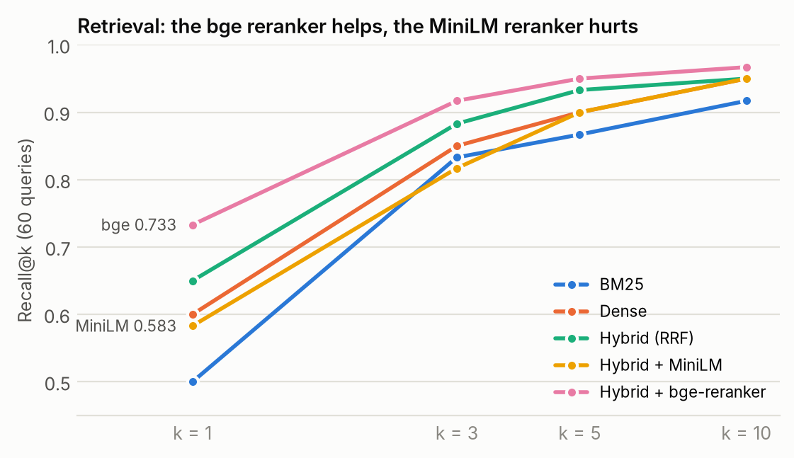

# 4. Retrieval

## 4.1 The corpus

742 documents from 35 official sources, one document per CFR section, tariff heading or note, FAQ or guidance article, frozen as `corpus-v1` with the SHA-256 of every download and extracted text (`data/rag-corpus/corpus/MANIFEST.json`). CFR text is pinned to the eCFR as of 2026-11-19; web pages were fetched on 2026-11-21.

| Authority | Documents | Examples |
| --- | --- | --- |
| Primary regulation | 449 | 19 CFR 148 (74 sections), 31 CFR 515 (144), 27 CFR 41 and 27 (193), HTSUS 9804, 9816, Ch. 98 notes and General Notes (26), 26 USC excise sections, 19 USC, E.O. 14068 |
| Agency guidance | 181 | OFAC Cuba FAQs (130) and Russia FAQs, CBP traveller and duty pages, CBP's article on Cuban cigars, TTB personal importation |
| Hard negatives | 103 | CBP pages on visitors, prohibited goods, food and agriculture, money; currency reporting (31 CFR 1010); and 19 CFR 148 Subpart G (7 crew sections, the same 50 / 10 / 150 ml limits as 148.51, never to be cited for a traveller) |
| State guidance | 5 | The five SPEC states' personal-import rules |
| Tax rates | 4 | TTB tax rate tables |

Each chunk carries a metadata header (source, section path, authority, tags, as-of date) inside its text, and its own `citation_id`, so a citation is always a regulation id taken from metadata, never written by the model.

**Chunking.** The embedding endpoint rejects any input over 512 tokens, and PDF text (HTSUS General Notes, CBP guides) has no blank lines, so the first chunker produced a 6,500-token "paragraph". Chunks are now cut at a hard limit counted with the embedding model's own tokenizer, splitting by lines, then sentences, then words, with table headers repeated (COMPENSATIONS row 2). At 350 tokens the corpus is 1,480 chunks, the largest 344 tokens, and no input was rejected.

## 4.2 The experiment (Days 5–7)

60 retrieval queries with gold `citation_id`s fixed before any run, including 3 crew-rule traps, scored on their own set, never on an eval set (rule 6). A query is a hit at k when any of the top k chunks carries a gold id. Four first-stage and reranking methods × hard-negative filter on or off × three chunk sizes (200, 350, 450 tokens) = 24 configurations (`results/retrieval_experiment.csv`), plus the second reranker.

At 350 tokens, hard negatives filtered:

| Method | R@1 | R@3 | R@5 | R@10 | MRR@10 | Hard negatives in top 3 | Traps hit@3 | ms/query |
| --- | --- | --- | --- | --- | --- | --- | --- | --- |
| BM25 | 0.500 | 0.833 | 0.867 | 0.917 | 0.670 | 0.00 | 3/3 | 1.4 |
| Dense (bge-small) | 0.600 | 0.850 | 0.900 | 0.950 | 0.726 | 0.00 | 2/3 | 1.0 |
| Hybrid, RRF k = 60 | 0.650 | 0.883 | 0.933 | 0.950 | 0.769 | 0.00 | 3/3 | 2.4 |
| Hybrid + MiniLM reranker | 0.583 | 0.817 | 0.900 | 0.950 | 0.712 | 0.00 | 2/3 | 66.7 |
| **Hybrid + bge-reranker-v2-m3** | **0.733** | **0.917** | **0.950** | **0.967** | **0.831** | 0.00 | **3/3** | 1,553 |

Source: `docs/RETRIEVAL.md`, `results/retrieval_experiment.csv`, `results/retrieval_experiment_bge.csv`. With 60 queries one query is 0.017.

*Figure 1. Recall@k by method (`eval/report_figures.py` from `results/retrieval_experiment*.csv`).*

## 4.3 Three decisions

1. **Retriever: hybrid BM25 + dense (RRF k = 60), reranked by `BAAI/bge-reranker-v2-m3` on the top 30.** BM25 finds exact section numbers and terms ("148.51", "Caribbean Basin"); dense finds paraphrases ("day trip to Mexico"); they miss different queries, so fusing wins at every chunk size. The two rerankers go opposite ways: `ms-marco-MiniLM-L-6-v2`, trained on web queries, lowers R@1 from 0.650 to 0.583 (14 queries down, 8 up); `bge-reranker-v2-m3` raises it to 0.733 (15 up, 7 down) and fixes the Cuban-origin ban (515.204, rank 5 → 1), the day-trip exemption (148.35, 4 → 1) and export-labelled tobacco (26 USC 5761, 9 → 2). It costs about 1.5 s a query on the Mac, small next to the model calls; plain hybrid stays as the fallback.
2. **Chunks of 350 tokens, k = 5.** 350 has the best R@3 and R@5 of the three sizes; 200 splits sections too small to match, 450 loses at R@3 and misses a trap. Five chunks of 350 tokens fit the under-3,000-token input target with room for the answer card.
3. **Filter on metadata before ranking; a flat numpy index, no vector database.** Excluding `hard_negative` chunks before ranking takes hard negatives in the top 3 from 0.10–0.20 to 0.00 for every method and never lowers recall: the reranker cannot pick a near-duplicate it never sees, which is the mentor's warning about near-identical CFR sections. The dense index is 1,480 × 384 floats (about 2.3 MB) and brute-force cosine takes about 1 ms, so Qdrant would add a service for no gain.

## 4.4 Search is not how the rules are found

With the chosen retriever, 5 of 60 queries still miss the top 3, among them the $200 no-pooling rule (148.51 is outranked by the $800 family-grouping section 148.34) and the USMCA free rate (not in the top 10). Both are rules the calculators apply. So the tools report the citation of every rule they applied (each `rules.yaml` and `rates.yaml` row carries one), `search_regulations` fetches those by id first, exactly, and free-text search fills the rest of the five-clause budget (COMPENSATIONS row 14: dev citation accuracy 0.00 for single_rag, 1.00 for the router). From agent v2 each rule's main source is fetched before its second-tier ones, and a clause can be cited only if its text is exactly a chunk of the frozen corpus (§6).

## 4.5 Recall next to end-to-end accuracy

| Set | Arm | Questions that reached search | Citation recall | Every gold citation retrieved | Accuracy when it was |
| --- | --- | --- | --- | --- | --- |
| eval-v2 | agent v1 | 55 | 0.965 | 0.927 | 0.843 |
| eval-v3 | agent v1 | 50 | 0.913 | 0.820 | 0.878 |
| eval-v3 | agent v2 | 61 | 0.967 | 0.934 | 0.982 |

Source: `docs/RECALL_VS_ACCURACY.md` (code router runs).

Search alone puts a gold clause in the top 5 for 95% of the retrieval queries; with the by-id fetch, agent v2 had every gold citation in front of the writer on 57 of the 61 eval-v3 questions that reached search, and 56 of those 57 are correct (the 57th is the E3-019 gold error). Each of the other 4 began with a misread fact, which sent the agent to a different rule and so a different source. **Retrieval is not the bottleneck; reading the question is.**
