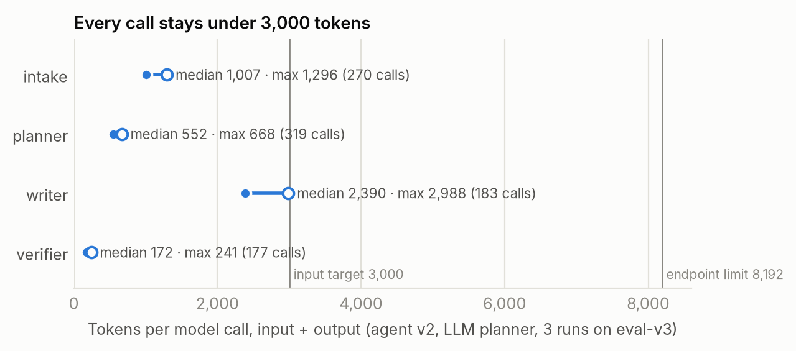

# 7. What did we do to compensate for a small model?

Qwen3-8B on a shared endpoint (8,192 tokens per call, one request at a time) cannot do customs arithmetic, does not know the regulations, never asks for a missing fact, and reads a question less reliably than it writes one. The design answer was one principle, applied everywhere: **the model reads and writes; code decides**. Every compensation below was logged when the weakness was seen, with a before and after from a scored run (`docs/COMPENSATIONS.md`, 31 rows). Held-out numbers are from eval-v2 (agent v1) and eval-v3 (agent v2); dev numbers are marked as tuned on.

## 7.1 The mentor's six weaknesses, measured

| Weakness | Compensation | Before | After |
| --- | --- | --- | --- |
| Arithmetic | Every amount from a calculator (`src/tools/`); rates as data with citations; the verifier rejects any number not in a tool output; from v2 the bottom-line sentence is built in code | $ accuracy 0.00–0.07 for the four prompting strategies, no calculators (eval-v2, n = 42) | 0.76 agent v1 (eval-v2); 0.77 agent v2 (eval-v3, n = 51). In v2 no wrong amount comes from a calculation: 11 of the 12 $ misses start with a misread fact, the 12th is a gold error (E3-019) |
| Unit and quantity extraction | Schema-constrained intake (`json_schema`); quantities passed as stated (`{value, unit}`) and converted by `normalise_units`; every fact checked against the question in code (`pipeline.clean`) | Agent v1 on eval-v3: 35 reading failures (20 missed, 11 wrong, 4 invented), 1 unit conversion | Agent v2 on eval-v3: 20 (11 / 5 / 4), 0 unit conversions |
| Rule interactions ($200 all-or-nothing, 2 L, under 21, Cuba) | Rules in `rules.yaml`, applied by code; restrictions checked before any calculation, enforced by the plan validator | Prompting: $200 all-or-nothing, 2 L and under-21 never right; Cuba right only with few-shot examples (0.83) | Rule-selection failures (`RULES`, facts right but tool result wrong): 1 agent v1 (eval-v2), 0 agent v2 (eval-v3). eval-v3: 2 L 1.00, under 21 1.00, Cuba 0.83 |
| Planning reliability | LLM planner checked against an allowed-step graph; one repair with the errors fed back; the code router's plan as fallback | First plans valid 1 of 16 (dev, row 13) | 13 of 16 first time, 16 of 16 after repair; 0 fallbacks in 6 official planner runs (71 and 87 planned questions each); 0 invalid plans executed |
| 8,192-token cap | Short prompts per stage; 5 clauses of ≤ 350 tokens; the writer sees only the answer card and those clauses | Target: < 3,000 input per call, 12,000 per question | Largest call 2,988 tokens, input and output together (writer); p95 2,521; 0 calls over 3,000; largest question 7,558 (planner) (`docs/TOKENS.md`) |
| Invented citations | Citations only from clauses retrieved for this question; each applied rule's citation fetched by id; from v2 only clauses whose text is exactly a frozen-corpus chunk | Citation accuracy 0.07 closed book, 0.00 decompose ("21 CFR 10.115" invented 63 times); single_rag 0.05 | 0.86 agent v1 (eval-v2), 0.79 agent v2 (eval-v3); a planted passage cited 3 times by v1 (E78, E3-049, E3-050), 0 by v2 |

Sources: `docs/BASELINES.md`, `docs/ABLATION.md`, `docs/METRICS.md`, `docs/TAXONOMY.md` (final labels), `docs/TOKENS.md`, COMPENSATIONS rows 13–14.

*Figure 4. Tokens per model call by stage, agent v2 with the LLM planner, three runs on eval-v3 (`results/token_calls.csv`).*

The citation figure is lower than retrieval recall because the check needs every gold source, and a question that ends in a needless clarifying question cites nothing. Of the 61 eval-v3 questions where agent v2 reached search, the writer had every gold citation in front of it on 57; each of the other 4 began with a misread fact, which sent the agent to another rule and so another source (`docs/RECALL_VS_ACCURACY.md`).

## 7.2 Weaknesses we found that the plan did not list

Most of the log is about one thing: **the 8B model reads facts into the schema that the traveller never gave, or drops ones they did**. The prompt alone did not fix it; each fix is code that checks the model's reading against the question.

| Symptom (first seen) | Fix in code | Evidence |
| --- | --- | --- |
| Copies numbers instead of converting units: "10 days" passed as `trip_hours = 10` | Tools never ask the model to convert; quantities are passed as stated | Row 3: probe 0/1 → 1/1 |
| Writes countries as names ("Trinidad", "Chile") though the schema asks for ISO codes, so the 2 L and free-trade rules are missed | Names and demonyms (124) mapped to ISO codes in code, no fuzzy matching | Row 5: D04, D20 0/2 → 2/2 |
| Fills in facts never stated: a 1-day trip, a 40% ABV, Italy as a vodka's origin, "not used" for the 30-day history | A fact is kept only if the question states it (age, trip length, ABV, origin for Cuban or Russian risk, history phrases); otherwise dropped, so it is asked | Rows 6, 11, 16: clarify 0.50 → 1.00 (dev), 0.667 → 1.00 (paraphrase); conversations 9/13 → 13/13 |
| Writes where an item was bought as its origin ("Cuban cigars bought in Cancún" → Mexico), missing the ban or under-charging | A stated origin next to the product wins; a 0%-duty origin is kept only when the question says where the item was made | Rows 9, 24 |
| Types products by guesswork: Champagne as still wine, liqueurs as "other", sake as spirits | Product names with a fixed tax class, as data with the TTB source | Row 20 |
| Does its own arithmetic in the explanation ("1.25 L over"), copies the prompt's example amount | Every intermediate number written out in the working; the bottom line built in code; unsupported sentences removed after the writer's retry | Rows 7, 31: dev-v2 verifier escalations of correct answers 3 → 0 |
| Labels outcomes loosely: a prohibited item "refused", an evasion "escalated" | Each outcome defined in the prompt with what belongs to it | Row 4: outcome accuracy 0.70 → 0.90 (closed book, dev) |
| Plain-language search returns CBP pages, not the deciding section | Tools report the rule they applied; its citation is fetched by id before free-text search | Row 14: citation accuracy 0.00 (single_rag) → 1.00 (router), dev |

## 7.3 What did not help

- **More sampling.** Self-consistency over three samples cost 3.7 times the tokens of a single closed-book call for 1 point of accuracy (0.113 vs 0.100) and a lower bottom-line score (0.56 vs 0.63) (`docs/BASELINES.md`).
- **The LLM planner.** It gives the same answer as the code router on every held-out question, for about 24% more tokens and one more model call (§5.3).
- **A general-purpose reranker.** `ms-marco-MiniLM-L-6-v2` lowered recall@1 from 0.650 to 0.583 on regulation text; `bge-reranker-v2-m3` raised it to 0.733 (§4).

## 7.4 How far the compensations generalise

The reading fixes are rules written from the phrasings seen. On dev-v2, where they were tuned, agent v2 scores 0.991; on eval-v3, written by the same generators and never seen, 0.77. 20 of its 23 eval-v3 failures still start in reading the question, and clarify precision is 0.43: it asks for every fact it should (recall 1.00) but also for facts the question gave. Code grounding makes the model's mistakes safe more often than it makes them right: 20 of the 23 failures give no wrong figure: a needless clarifying question, a question for the wrong facts, or an escalation. 2 are unsafe (§6.3), and 1 is the gold error. The next compensation would be to ask the model for the span of the question each fact comes from, so the check is against the model's own evidence rather than a list of phrasings.
