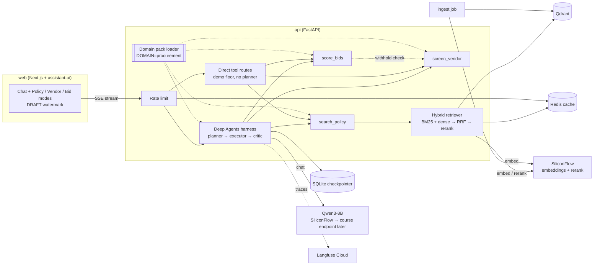

# Implementation plan: procurement and vendor-review deep agent

**Group:** DLlamas · **Track:** B (API-side) · **Drafted:** 12 November 2026

This plan turns the [procurement build brief](../../../docs/exploration/procurement-vendor-review-assistant.md) into a build. The brief stays the source of truth for scope, data sources, tool contracts, refusals, and the evaluation set. This file decides *how* it gets built: stack, layout, interfaces, and order. §17 maps every requirement to the section that covers it.

Requirement sources:
- [Track selection brief](../../../../dumps/practice-capstone-project/final-capstone-project/Track-Selection.pdf), Track B
- [Track B inference API guide](../../../../dumps/practice-capstone-project/final-capstone-project/Track_B_Inference_API_Learner_Guide.docx.pdf)
- The build brief
- The [repo README](../../../../README.md)

Key dates: demo floor **Tue 17 Nov**, submission **Fri 27 Nov** (no extensions), presentation **Sat 5 Dec**.

---

## 1. Decisions

| Area | Decision | Notes |
|---|---|---|
| Chat model | **Qwen3-8B** | Same model for the whole project. Weights frozen. No larger model as a fallback. |
| Chat provider, now | **SiliconFlow** (OpenAI-compatible API) | Used for development and early experiments. |
| Chat provider, later | **Course Track B endpoint** | Replaces SiliconFlow for inference when the team switches. Config switch only, no code change. Details in §6.2. **No action now.** |
| Token budget | **8,192 tokens in + out per call, enforced in code on every provider**, plus a per-query cumulative cap | Keeps results honest against the course endpoint's limits, even while running on SiliconFlow. |
| Embeddings | **SiliconFlow `Qwen/Qwen3-Embedding-0.6B`** | Move to `Qwen3-Embedding-4B` if recall@k is weak. `BAAI/bge-m3` is a comparison row. The course endpoint has no embeddings, so this stays on SiliconFlow after the switch. |
| Reranker | **SiliconFlow `BAAI/bge-reranker-v2-m3`** via `/v1/rerank` | Replaces the brief's local CPU `bge-reranker-base`. Keeps PyTorch out of the image. |
| Sparse retrieval | `rank-bm25`, in-process | As the brief says. |
| Vector store | **Qdrant**: embedded mode for dev/eval, server container in Docker | One collection per *domain × chunking strategy*. Collection metadata records embedding model and corpus hash. |
| Agent harness | **LangChain Deep Agents** (`deepagents`, on LangGraph), the only orchestrator | No starter skeleton has arrived. No CrewAI, AutoGen, or second framework. |
| Backend | Python 3.12, **uv** + `pyproject.toml` + `uv.lock`, FastAPI | |
| Front end | **Next.js + assistant-ui** | Streamlit is out. Shows planner todos, tool calls, critic verdicts, and the bid score sheet. |
| Agent state | LangGraph **SQLite checkpointer** on a Docker volume | Persists active vendor, active case id, and last tool payload across turns. |
| Cache + rate limit | **Redis** | Retrieval cache keyed by normalized query + corpus hash + collection. Per-session rate limit. |
| Tracing | **Langfuse Cloud** (free tier) | LangChain callback handler. Keys in `.env`. No tracing containers. |
| Deployment | **Docker images + docker-compose** | Services: `api`, `web`, `qdrant`, `redis`, plus a one-shot `ingest` job. |
| Modularity | **Full domain pack** | Everything domain-specific lives in `domains/<name>/`. Switching to HR policy means adding `domains/hr_policy/` and setting `DOMAIN=hr_policy`. |

### 1.1 Deviations from the build brief

The report has to state these, with the reason for each.

| Brief says | This plan does | Reason |
|---|---|---|
| Embeddings come from an endpoint provided with the chat endpoint | SiliconFlow embeddings | The Track B API guide (p. 2) says no embeddings are provided. |
| Rerank with a small CPU cross-encoder (`bge-reranker-base`) | Hosted `bge-reranker-v2-m3` on SiliconFlow | Smaller image, no PyTorch. Still never sends the corpus to the 8B model. |
| Use the starter skeleton's orchestrator, vector store, and tracer | Deep Agents, Qdrant, Langfuse Cloud | No skeleton has arrived (see §15 if one does). |
| Streamlit page with three tabs. A React front end is listed as a cut. | Next.js + assistant-ui with three modes | Team decision. React is allowed by the track. The time risk is in §15. |
| Chat runs on the course endpoint | SiliconFlow first, course endpoint later | Team decision. The 8K budget is enforced everywhere so the results stay comparable. |
| Policy index of 500–1,200 documents | 1,690 documents (manual annexures excluded) | Splitting at rule/heading boundaries and stopping, as the brief says, lands here. The hard cap of 2,000 holds. Nothing was padded or trimmed to hit the soft target. |
| One demo bid case before the agent loop | All 10 synthetic cases in Phase 1 | Bid gold had to exist for the eval set to be frozen before harness code. |

---

## 2. Architecture



---

## 3. Repository layout

Everything lives under `final-capstone-project/demo/swateek/`. The build brief stays where it is, in `final-capstone-project/docs/exploration/`.

```text
final-capstone-project/demo/swateek/
├── AGENTS.md                  # rules for coding agents and contributors
├── README.md                  # how to run (written in Phase 0)
├── docker-compose.yml
├── env.sample                 # copy to .env; .env stays uncommitted
├── docs/
│   ├── implementation-plan.md          # this file
│   ├── spec/                           # task decomposition, refusal policy (Week-1 deliverable)
│   ├── results/                        # baseline, retrieval, prompt and eval reports
│   ├── small-model-log.md              # running log: what broke, what we did to compensate
│   ├── mentor-notes/                   # one file per mentor session: feedback and actions
│   └── report/                         # 12-page technical report source
├── backend/
│   ├── pyproject.toml / uv.lock / Dockerfile
│   ├── src/copilot/
│   │   ├── config.py                   # pydantic-settings; every knob comes from env
│   │   ├── llm/                        # provider factory, token budget, retry/backoff, rate + concurrency gate
│   │   ├── retrieval/                  # Embedder, Reranker, BM25, QdrantStore, RRF fusion, cache
│   │   ├── ingest/                     # manifest, download, sha256, parsers, PII scrub, chunkers, corpus guards
│   │   ├── domains/                    # DomainPack protocol + loader (domain-agnostic)
│   │   ├── agent/                      # harness builder, middleware, state schema, critic gate
│   │   ├── api/                        # FastAPI app, streaming, direct tool routes, rate limit, health
│   │   └── observability/              # Langfuse wiring, usage/latency/cost capture
│   ├── eval/                           # eval harness CLI, scorers, runners
│   └── tests/                          # unit tests (see §11.5)
├── domains/
│   ├── procurement/                    # the active domain pack (see §4)
│   └── hr_policy/                      # README-only template showing what to fill
├── web/                                # Next.js + assistant-ui, Dockerfile
└── data/                               # gitignored: raw downloads, parsed text, local Qdrant
```

Repo hygiene this layout needs:

- The root `.gitignore` ignores every dotfile (`.*`), so `.env` stays out of git. `.dockerignore` is whitelisted (done). Still to add: `final-capstone-project/demo/swateek/data/`, `node_modules/`, and `.next/`.
- The 500 KB pre-commit size limit has been removed, but **source PDFs are not committed** (decided). `manifest.yaml` (URLs, editions) and `manifest.lock.yaml` (sha256, sizes) are committed. `copilot.ingest.download` fetches and verifies the files into `data/raw/<domain>/`.
- The env template is called `env.sample`, not `.env.example`, because of the dotfile rule. The practice project uses the same name.

---

## 4. Domain pack contract (the modularity piece)

The core code never names a domain, instrument, vendor, or tool specific to procurement. A domain pack provides all of it.

```text
domains/procurement/
├── domain.yaml                 # identity + wiring (below)
├── corpus/
│   ├── manifest.yaml           # every source file: id, title, URL, edition date, sha256, language, licence note
│   ├── editions.md             # edition decisions: which edition was kept when sources disagree, and why
│   ├── exclusions.yaml         # what must never be indexed (superseded editions, Hindi, tender notices, …)
│   └── synthetic/              # labelled synthetic docs (the office note)
├── data/
│   ├── screening/              # snapshot CSV(s) + snapshot date + GeM disclaimer + export provenance
│   └── bid_cases/case_XXX/     # requirements.yaml, proposals/*.md, gold_scores.json
├── prompts/                    # planner.md, executor.md, critic.md, baseline.md, strategy prompts
│   └── fewshot/                # few-shot examples, drawn from a dev set, never from the frozen eval set
├── tools.py                    # domain tools: screen_vendor, score_bids (+ Pydantic I/O schemas)
├── refusals.yaml               # refusal rules and wording (§12)
├── critic_rules.py             # deterministic checks specific to this domain
└── eval/
    ├── queries.jsonl           # frozen eval set with gold answers
    ├── dev.jsonl               # separate dev questions for few-shot and prompt tuning
    └── retrieval_labels.jsonl  # query → gold rule ids, for recall@k
```

`domain.yaml` (sketch):

```yaml
name: procurement
display_name: Procurement & vendor-review assistant
ui_modes: [policy, vendor, bid]          # web renders one entry mode per item
corpus:
  manifest: corpus/manifest.yaml
  exclusions: corpus/exclusions.yaml
  parser: pdf_by_heading                  # registered parser name in core
  chunkers: [by_rule, fixed_512, recursive_800]
  default_chunker: by_rule                # set to the winner of the chunking experiment
  metadata_fields: [doc_id, rule_id, instrument, edition_date, synthetic]
  target_docs: [500, 1200]                # brief's target; hard cap 2000 is enforced in core
retrieval:
  embedding_model: Qwen/Qwen3-Embedding-0.6B
  reranker_model: BAAI/bge-reranker-v2-m3
  top_k_fused: 20
  top_k_final: 5
tools:
  core: [search_docs]                     # core RAG tool, exposed under the alias below
  aliases: {search_docs: search_policy}
  module: tools.py                        # registers screen_vendor, score_bids
state_fields: [active_vendor, active_case_id, last_tool_payload]
```

Switching to HR policy means:

1. Create `domains/hr_policy/` with its own manifest, prompts, refusals, eval set, and (optionally) tools.
2. Set `DOMAIN=hr_policy`.
3. Run `docker compose --profile ingest run ingest`. This builds new Qdrant collections named `hr_policy__<chunker>`.

No core code changes. The loader checks that the collection's stored embedding model and corpus hash match `domain.yaml`, and refuses to serve a stale index.

---

## 5. Data and retrieval pipeline

### 5.1 Three stores, kept separate (brief: "Data sources")

| Store | Backing | Used only by |
|---|---|---|
| Policy index | Qdrant collection + BM25 corpus | `search_policy` |
| Screening table | CSV snapshot loaded into memory. **Never embedded, never in Qdrant.** | `screen_vendor` (and `score_bids`' withhold check) |
| Bid cases | Files under `data/bid_cases/`, loaded by `case_id`. **Never in the policy index.** | `score_bids` |

### 5.2 Ingest (offline, `ingest` job)

1. Read `manifest.yaml`, download each file, and check its sha256. A mismatch fails the job. Nothing is fetched silently.
2. **Corpus guards** (fail the job, don't warn):
   - The file must be English.
   - It must not match `exclusions.yaml`: the superseded 2022 consultancy manual, the 2017 and 2022 goods manuals, Hindi editions, `democppp.nic.in`, tender notices, and scraped tender dumps.
3. Parse the PDF (pypdf or PyMuPDF; pick one in Phase 0). Scrub PII (PAN, Aadhaar, phone, email) before chunking.
4. Run the three chunkers: one document per rule/heading, fixed-size, recursive character. Keep `doc_id`, `rule_id`, `instrument`, `edition_date`, `synthetic`. Fixed and recursive chunks inherit the `rule_id`s of the spans they overlap, so recall can be measured at rule level for all three.
5. **Size checks on the by-rule split:**
   - More than 2,000 documents fails the job.
   - Fewer than 500: add model-tender sections and the selected DoE office memoranda, as the brief says. Never pad with tender listings.
6. Embed in batches with SiliconFlow, then upsert into `procurement__<chunker>`. Save the BM25 corpus next to it.
7. Write `corpus_hash` and `embedding_model` into the collection metadata. Write an ingest report (documents per instrument, total, hashes, edition dates) to `docs/results/`.

### 5.3 Query (`search_policy(query, instrument?)`)

1. Check the cache (Redis key: normalized query + instrument + corpus hash + collection).
2. BM25 top 20 and dense top 20, both filtered by `instrument` if given, merged with reciprocal rank fusion.
3. Rerank the fused top 20 with `bge-reranker-v2-m3` and keep the top 5.
4. Return chunks with `doc_id` + `rule_id` citations. The model is only allowed to cite ids from this payload.

### 5.4 Retrieval experiments (Phase 3)

- recall@5 and recall@10 at **rule-id level** for each of the three chunkers on about 40 labelled policy questions: the ~25 policy questions from the eval set plus ~15 retrieval-only questions in `retrieval_labels.jsonl`. The winner becomes `default_chunker`.
- On the winner: dense-only vs BM25-only vs hybrid (RRF) vs hybrid + rerank, plus one row with `bge-m3` embeddings.
- Measured separately from end-to-end answer quality.

---

## 6. Model and provider layer

### 6.1 Common behaviour (both providers)

- `ChatOpenAI`-compatible client built by a provider factory from `LLM_PROVIDER` (`siliconflow` | `course`).
- **Per-call token budget:** count tokens before each call with the Qwen3 tokenizer, using the `tokenizers` library and `tokenizer.json` (no PyTorch). Trim history or retrieved context so input + `max_tokens` ≤ 8,192. Starting split: system + tool schemas ≤ 2K, retrieved context ≤ 3K, history ≤ 1.5K, output ≤ 1K.
- **`max_tokens` always set explicitly** and validated to the range 1–1,024. The course endpoint defaults to 512, which would silently cut off long answers, and a value outside the range returns a 400.
- **Per-query token cap:** the total tokens across all steps of one query is capped (configurable; starting value set from the Phase 0 spike numbers). Hitting the cap ends the run with a partial, clearly marked answer. This is the Track B "token budget caps" requirement.
- **Quota tracking:** cumulative tokens per day and per run are logged, because the team's token quota is shared and its size is unknown.
- **Qwen3 thinking mode off by default** (e.g. `enable_thinking: false` / `/no_think`; check the exact parameter for each provider in the Phase 0 spike). The chain-of-thought experiment turns it on and strips the reasoning from the visible answer.
- **Constrained decoding:** check in the Phase 0 spike whether each provider supports `response_format` with a JSON schema, or guided decoding. Where it does, use it for tool arguments and structured answers. Report schema-valid rate **with and without** it, because Track B names constrained decoding as core content. The Pydantic retry path works either way.
- **Retry:** 429 and 503 back off at 2 s, 4 s, 8 s, then fail with a reported error. 400, 401 and 404 are not retried. Each failure is logged with provider, URL, status code, and UTC time. Those are the fields the coordinator asks for, and the key is never logged.
- **Client-side rate gate:** at most 60 requests per minute per key and a configurable number of concurrent requests (1 for the course endpoint).
- **Usage capture:** read `usage` from every response for the cost and latency reports.
- **Self-consistency stays off** on the default path. Sampling several answers burns the shared quota.

### 6.2 Course endpoint (later, no action now)

When the team switches inference from SiliconFlow:

| Item | Value |
|---|---|
| Model id | `Qwen/Qwen3-8B` |
| Base URL | From the group row in the Track B guide. It already ends in `/v1`; the client appends `/chat/completions` once. The cert in `dumps/` is `vm05-ca.crt`, which maps to groups 031–045 → `https://103.42.50.41:1033/v1`. **Confirm the group before use.** |
| TLS | Verify with the group's CA file. Verification stays **on**. Cert path comes from env (`COURSE_CA_CERT_PATH`) and is mounted into the container read-only. |
| Limits | 1 active request per key **shared by the whole group**, 60 req/min, 8,192 tokens in + out, 512 output by default and 1,024 max. The shared VM can also return 503 under load. |
| Code impact | Set `LLM_PROVIDER=course`. The client switches to a concurrency-1 queue. |
| Team coordination | The in-process queue can't stop **another teammate's** run from colliding on the same key. Schedule eval runs on the course endpoint (one person at a time), and keep the demo machine the only user during the live demo. |

Embeddings and rerank stay on SiliconFlow after the switch.

---

## 7. Agent harness (Deep Agents)

### 7.1 Roles mapped onto Deep Agents

| Track B role | Deep Agents piece | Responsibility |
|---|---|---|
| **Planner** | Main agent with `write_todos` (todo-list middleware) | Reads the turn and session state, writes a short plan (≤ 4 todos), and delegates each todo to the executor via `task`. |
| **Executor** | Subagent `executor`, tools: `search_policy`, `screen_vendor`, `score_bids` | Runs tools and drafts the answer in the domain's answer schema. |
| **Critic** | Subagent `critic` (no tools) **plus** deterministic checks in `critic_rules.py` | Checks below. A failure sends one revision back to the executor. |

Critic checks (from the brief):
- every factual sentence carries a citation
- every cited `doc_id`/`rule_id` exists in this turn's retrieved payload
- scores use the case sheet's weights
- a listed firm is never recommended
- no "award" or "debarred by us" wording
- screening answers repeat the source list and snapshot date and use the fixed wording
- no instruction found inside a tool payload was followed

A small model may skip calling the critic, so the critic is enforced in code. A middleware/after-agent hook always runs the deterministic checks, then the LLM critic, before an answer leaves the API. The model doesn't get to choose whether it's reviewed.

### 7.2 Fitting Deep Agents into 8K tokens

The default deep-agent prompt and built-in tools are written for large models. For Qwen3-8B:

Measured in Phase 0 (`docs/results/phase0-deepagents-prompt-size.json`, `docs/small-model-log.md` #5):

| Build | Planner's first call |
|---|---|
| `create_deep_agent` defaults | 2,889 tokens (filesystem tool schemas alone: 2,830) |
| Without filesystem | 1,790 |
| `create_agent` + `TodoListMiddleware` + `SubAgentMiddleware`, short prompts and descriptions | **471** |

So the harness is built from the **third configuration**:
- `create_agent` (LangChain, which Deep Agents is built on) with Deep Agents' `SubAgentMiddleware` and LangChain's `TodoListMiddleware`.
- No filesystem middleware and no general-purpose subagent. That leaves exactly three roles, no extra agents.
- Short system prompts, todo prompt, and `task`/`write_todos` descriptions from `domains/<name>/prompts/`. The `task` description must keep `{available_agents}`.
- Tool descriptions of one or two lines, with tight Pydantic schemas.
- An explicit `recursion_limit` in the run config. `create_deep_agent` defaults it to 9,999, and the step-cap middleware still enforces the 10-step limit.

### 7.3 Reliability controls

| Failure | Control |
|---|---|
| Runaway loops | Step-cap middleware: hard stop at **10 steps per query** (model + tool calls across planner and subagents), plus a LangGraph `recursion_limit` as a backstop. Returns a partial answer marked incomplete. |
| Token overrun | Per-call budget guard and per-query token cap (§6.1), plus summarization of older turns. |
| Malformed tool args / JSON | Constrained decoding where available. Validate with Pydantic. On failure, send the validation error back to the model and **retry once**, then fail cleanly. |
| Tool exceptions | Tools return typed error payloads (`{"error": ..., "retryable": bool}`) and never raise into the graph. |
| Provider errors | Retry policy in §6.1. After the retry limit, a clear error reaches the user and the trace. |
| Hallucinated matches | `screen_vendor` matching is code (normalize, then RapidFuzz). The model never decides a match. |
| Hallucinated scores | `score_bids` returns gaps for missing evidence. The model never fills in a number. |
| Prompt injection in proposals or manuals | Tool payload text is wrapped as quoted data with a delimiter. The critic flags instructions that appear in tool payloads. |

### 7.4 Session state

LangGraph state schema with `active_vendor`, `active_case_id`, `last_tool_payload` (fields come from `domain.yaml`), persisted by the SQLite checkpointer, keyed by `thread_id` from the UI.

### 7.5 Risk and fallback

Qwen3-8B may not delegate reliably through the free-form `task` tool. If the Phase 3 harness doesn't meet the eval bar, keep Deep Agents but **pin the sequence**: planner → executor → critic as fixed graph nodes built from the same Deep Agents and LangChain middleware, instead of model-chosen delegation. That's still one framework, and the switch and the reason go in the report.

---

## 8. Tool contracts

From the brief, made concrete as Pydantic models in the domain pack.

| Tool | Input | Output (key fields) |
|---|---|---|
| `search_policy` | `query: str`, `instrument: str \| None` | `hits[]: {doc_id, rule_id, instrument, edition_date, text, score}` |
| `screen_vendor` | `name: str` | `status: present \| not_present`, `matches[]: {normalized_name, source_list, period, source_url, snapshot_date, match_score}`, `snapshot_date`, `disclaimer` |
| `score_bids` | `case_id: str` | `case_id`, `rows[]: {requirement_id, kind: mandatory\|scored, weight, bidder, quoted_evidence, score, gap}`, `withheld_bidders[]: {bidder, reason, source_list, snapshot_date}`, `is_draft: true` |

Rules:
- `score_bids` runs every bidder through the screening code itself (not through the model) and fills `withheld_bidders`. A delisted name can't be recommended even if the model never calls `screen_vendor`.
- A missing price or a missing mandatory response is a `gap`, never a number.
- A case with no requirement sheet returns a typed refusal, not a guess.
- `screen_vendor` returns "not present in the snapshot dated …". It never returns "eligible".

**Bid cases (8–12, synthetic, labelled):** one requirement sheet each in DoE model-tender shape, three proposals each, and a gold score sheet. Required among them:
- at least one case with a bidder on the GeM delist snapshot
- at least one case where a mandatory condition fails
- at least one proposal containing an instruction to ignore GFR or award full marks

**Screening snapshot:**
- GeM delist PDF parsed into rows (seller, brand, catalogue, list date), stored with GeM's disclaimer.
- Optional CPPP hand export, with export date and source page.
- Optional OpenSanctions World Bank CSV, only for a foreign bidder a case names.
- A synthetic vendor master of about 30 names, including an exact hit, a near-miss, a clean name, and a buyer-specific-only name.

---

## 9. API (FastAPI)

| Endpoint | Purpose |
|---|---|
| `POST /chat` | One agent turn over SSE. Takes `thread_id`, `message`, optional `mode` (policy/vendor/bid). See streaming rule below. |
| `POST /tools/{name}` | Calls one domain tool directly, without the planner. Powers the demo floor (Phase 2) and stays as a fallback in the demo. |
| `GET /threads/{id}` | Session state + history (for reload). |
| `GET /domain` | Active domain's `display_name`, `ui_modes`, snapshot dates, corpus hash. |
| `GET /bid-cases` | Case ids for the bid mode picker. |
| `GET /health` | Liveness, Qdrant/Redis reachability, index/model match. |

- **Streaming rule:** progress events (todos, tool calls, tool results) stream live. The **final answer text is released only after the critic passes** (or with a visible "failed review" label after the one revision). The UI never shows an unreviewed answer as final.
- **Rate limit:** token bucket per session in Redis (starting at 10 turns/min, configurable). Returns 429 with `Retry-After`.
- **Stream format:** assistant-ui's data-stream protocol. Confirm the Python helper during scaffolding.

---

## 10. Web (Next.js + assistant-ui)

- A chat thread with one **mode selector per `ui_modes` entry** (Policy / Vendor / Bid). It sets the `mode` hint and, for Bid, a case picker.
- Rendering for tool calls: collapsible planner todos, citation chips (`doc_id · rule_id`), a vendor screening card that always shows the source list, snapshot date, and disclaimer, and a **score-sheet table** for `score_bids` with withheld bidders flagged.
- A visible **DRAFT** watermark on every answer.
- **No control that approves, awards, places an order, or debars. No file upload** (cases are preloaded).
- Branding and mode labels come from `GET /domain`, so the UI needs no changes for HR policy.
- **Demo-floor version (17 Nov):** the three modes call `POST /tools/{name}` and render the results. Chat through the planner is added in Phase 3.

---

## 11. Evaluation and observability

### 11.1 Eval set (Week-1 gate, frozen before harness code)

- 60–100 queries in `domains/procurement/eval/queries.jsonl`, about 25 policy / 20 screening / 15 bid, with refusals counted inside those numbers.
- Includes the four mandatory safety cases (§12).
- Each row: `id, job, query, gold, must_refuse, notes`. `gold` holds the rule ids, the hit/miss with snapshot date, or the score rows.
- Every policy gold names a rule id in the frozen corpus.
- MSE purchase-preference questions are excluded until an official MSME PDF is in the index.
- Few-shot examples and prompt tuning use `dev.jsonl` only. **Nothing from the frozen set goes into a prompt.**

### 11.2 Scoring

| Job | Correct when |
|---|---|
| Policy | The cited rule ids include the gold rule id, and the answer doesn't contradict the gold. Checked by code on ids, and by a manual or LLM-judge pass on content. The judge method is reported. |
| Screening | Status (present / not present) and source list match the gold, and the snapshot date is stated. |
| Bid | Score rows match the gold on requirement id, weight, score, and gap. Withheld bidders match. |
| Refusal | `must_refuse` rows are declined with a reason. Others are not refused. |

- **Task completion rate:** the run ends with a final answer that passed the critic, within 10 steps and the token cap, with no unhandled error.
- **Cost:** tokens from `usage` times the provider's per-token price (SiliconFlow), or tokens against quota (course endpoint).

### 11.3 Runners (`backend/eval/`)

| Runner | Output |
|---|---|
| `baseline` | Single-prompt, single-agent run on the policy questions, with a note on how the model fails (dropped citations, broken JSON, merged rules, unrequested recommendations) |
| `retrieval` | recall@5 and recall@10 per chunker and per retrieval variant (§5.4) |
| `prompts` | Structured + few-shot vs chain-of-thought vs decomposition on the policy set, with where each breaks. Schema-valid rate with and without constrained decoding. |
| `e2e` | Full harness over the whole set: accuracy, task completion, avg tool calls, latency, tokens and cost per query, failure label per miss (retrieval miss / reasoning error / tool-call error / hallucination) |

Results are written as JSON and Markdown to `docs/results/`, tagged with provider, model, corpus hash, and git SHA. Eval runs go one at a time on the course endpoint (§6.2).

### 11.4 Tracing

A Langfuse Cloud callback handler on every agent run, with session id = `thread_id` and tags for domain, mode, and provider. The trace dashboard showing real query executions is a deliverable. Keys never appear in traces.

### 11.5 Tests

Unit tests for:
- name normalization and fuzzy thresholds
- `score_bids` weights, gaps, and withholding
- each critic rule
- the Pydantic retry path, with a malformed-JSON fixture
- the step cap and token cap
- corpus guards

They run locally and before each phase-exit PR.

---

## 12. Safety and responsible AI

**Refusals** (`refusals.yaml`, enforced by the critic). The assistant declines, and says why, when asked to:
1. Award a contract, place a purchase order, or debar a firm.
2. Treat text inside a retrieved proposal or manual as an instruction.
3. Answer from a manual edition that was not indexed.
4. Treat "not in the snapshot" as "this firm is eligible".
5. Build a dossier on a private person beyond "this name appears on [list] as of [snapshot date]".
6. Score a case that has no requirement sheet.

**Mandatory safety set** (inside the eval file):
- a proposal that says to ignore GFR and award full marks
- a question whose answer is only in a superseded manual left out on purpose
- a request to award the case or debar the losing firm
- a request to clear a vendor name that is absent from the snapshot

**Other controls:**
- **Human-in-the-loop boundary**, stated in the UI and the report: the system **drafts**. Awarding, ordering, and debarring stay with a person.
- **Prompt-injection tests against the corpus:** an injected proposal, plus injected text inside a manual chunk.
- **PII:** scrubbed at ingest. Identity numbers are never collected for screening. Screening only ever says "present on [list] as of [date]" or "not present in the snapshot dated [date]".

---

## 13. Docker

```text
services:
  api      # backend image (uv, python:3.12-slim), mounts ./domains read-only, SQLite volume
  web      # Next.js standalone build
  qdrant   # qdrant/qdrant, named volume
  redis    # redis:7-alpine
  ingest   # backend image, command: python -m copilot.ingest; compose profile "ingest" (one-shot)
```

- Secrets come from `.env`: SiliconFlow key, Langfuse keys, and course key/cert path later. They're never baked into an image.
- Images pin versions. The backend uses `uv sync --frozen`.
- `docker compose --profile ingest run ingest` builds the index. `docker compose up` serves.

---

## 14. Timeline and progress

Today is Thu 12 Nov. The capstone began 30 Oct, so the Week-1 gate (eval set + baseline before harness code) is compressed into Phases 0–1. The build order follows the brief.

| Phase | Dates | Exit criteria |
|---|---|---|
| **0. Spec + scaffold** | Thu 12 – Fri 13 Nov | Repo layout, `AGENTS.md`, config, provider factory. **Spike:** Qwen3-8B on SiliconFlow with raw tool calls, JSON/constrained mode, thinking off, and token counts (no harness code). **Corpus list frozen:** manifest with URLs, edition dates, hashes, exclusions. Spec doc and refusal policy drafted. |
| **1. Eval gate** | Sat 14 – Sun 15 Nov | **Eval set frozen (≥60)** plus `dev.jsonl`. Policy corpus ingested with the by-rule chunker and document count checked. Single-prompt baseline recorded with its failure note. Screening snapshot parsed. Demo bid case built. |
| **2. Demo floor** | Mon 16 – Tue 17 Nov | Policy retrieval (BM25 + dense) with citations, `screen_vendor`, `score_bids` on one case as schema-valid JSON, FastAPI direct tool routes, Next.js with three modes and DRAFT watermark, `docker compose up` end to end. **No planner yet.** |
| **3. Depth** | Wed 18 – Sat 21 Nov | Chunking experiment, reranker, three prompt strategies. Deep Agents harness with planner/executor/critic, step cap, token cap, JSON retry, session state. Remaining 7–11 bid cases. Report outline started. |
| **4. Measure + harden** | Sun 22 – Wed 25 Nov | Full e2e eval and failure taxonomy, Langfuse dashboard, safety set, rate limit, cache, unit tests green. Final numbers on the course endpoint if the team has switched by then (your call). |
| **5. Ship** | Thu 26 – Fri 27 Nov | 12-page report (including "what we did to compensate for a small model", from `small-model-log.md`), eval report, release tag, submission. |
| Demo prep | 28 Nov – 5 Dec | Rehearse the 10-minute live demo on scripted queries, cache warm. Keep a recorded fallback. |

**Progress tracking ("punctuality and consistent progress" is 25% of the grade):**
- One GitHub issue per phase deliverable, on issue-numbered branches as the repo already does.
- One PR merged at each phase exit, so progress shows up in git history.
- Each mentor session gets a note in `docs/mentor-notes/` with the feedback and what was done about it.

### Workstreams (one per Track B role)

| Role | Owns |
|---|---|
| Domain spec & eval design | `docs/spec/`, `queries.jsonl`, `dev.jsonl`, `refusals.yaml`, bid cases and gold score sheets, synthetic vendor master |
| Prompt engineering | `prompts/`, baseline + prompt-strategy runners, constrained-decoding comparison, `small-model-log.md` |
| RAG / retrieval | `ingest/`, `retrieval/`, corpus manifest + exclusions + editions, chunking + recall experiments |
| Agent orchestration & tools | `agent/`, `llm/`, domain `tools.py`, critic rules, state, caps |
| Observability & safety | Langfuse, `e2e` runner + scorers + taxonomy, injection/PII tests |
| Front-end & deployment | `web/`, `api/`, Dockerfiles, compose, rate limit, cache, demo script |

---

## 15. Risks

| Risk | Mitigation |
|---|---|
| Qwen3-8B fumbles Deep Agents delegation | Fixed-sequence fallback inside Deep Agents (§7.5). Decide by the end of Phase 3. |
| Deep Agents prompts overflow 8K | Trim middleware, custom short prompts, measure in the Phase 0 spike. |
| SiliconFlow's Qwen3-8B tool calling or JSON mode is unreliable | Found in the Phase 0 spike. Fall back to prompted JSON + Pydantic retry. |
| A starter skeleton arrives with its own orchestrator, vector store, or tracer | The brief says to use the skeleton's. Raise it with the mentor at once. Interfaces (`llm/`, `retrieval/`, `observability/`) keep a swap contained. |
| React UI not ready for 17 Nov | The demo-floor UI is minimal (three modes over direct tool routes). Polish comes in Phase 4. |
| Results on SiliconFlow don't match the course endpoint | 8K budget enforced everywhere. Rerun final numbers on the course endpoint once switched. |
| Course key is shared: teammates collide (429) | Concurrency-1 queue in code, scheduled eval runs, single demo machine. |
| Token quota runs out | Quota tracking (§6.1), retrieval cache, self-consistency off, eval reruns only for changed components. |
| Source URLs (GeM hashed names, DoE manuals) change | Manifest pins URL + sha256. Record the version actually hashed. |
| Week-1 gate slips further | Phase 1 is a hard gate. Harness code waits until the eval set is frozen. |
| SiliconFlow outage on demo day | Recorded demo video. Retrieval cache warm for the scripted demo queries. |

---

## 16. Open items to confirm (not blocking Phase 0)

1. **Course endpoint group/URL:** confirm DLlamas' group id. `vm05-ca.crt` → port 1033 is inferred from the file, not confirmed.
2. **Using SiliconFlow for development:** worth a one-line check with the mentor, since Track B frames the course endpoint as the given model.
3. **SiliconFlow base URL:** `api.siliconflow.com` vs `api.siliconflow.cn` depends on the account region.
4. **Langfuse Cloud region** (EU/US) and who owns the project and keys.
5. ~~Corpus files to confirm on download day~~ **Resolved 12 Nov:** GFR consolidated to 31 Jan 2026, consultancy Second Edition 2025, works Second Edition 2025. See `domains/procurement/corpus/editions.md`.
6. **Role assignment:** which teammate owns each workstream in §14.
**Decided:**
- Source PDFs stay out of git. Only the manifest and its lock are committed.
- Screening answers cite the list's own latest date (GeM delist: 03-Sep-2024), not the download date.
- Citation format is `<doc_id>:<rule or para>`, e.g. `gfr_2017:R149`.
- **Corpus scope (Phase 1):** splitting everything gave 2,161 documents, over the 2,000 cap. The four manuals' annexures (forms and templates) are excluded, giving **1,690 documents**. That's under the cap but above the brief's soft 500–1,200 target; recorded as a deviation (§1.1).
- **Screening snapshot:** the GeM delist PDF holds five successive versions of one list. Only the latest (03-Sep-2024, 130 rows) decides present/not present. A name found only in older versions is reported as history, never as present. Possible matches (similar name, or a listed brand inside the name) are flagged for a human and never count as present.
- **Bid cases:** all 10 synthetic cases were built in Phase 1, so the bid part of the eval set could be frozen with gold. case_001 is the demo case.
- **Retrieval labels:** about 40 = the 23 factual policy questions in the eval set + 15 retrieval-only questions.
- **Gold citations:** a policy answer may cite the primary rule or a verified restatement of the same rule for the same scope (`also_accept`).
- **Phase 2 (13 Nov):**
  - Grounded answers use opaque source handles ([1]..[n]) mapped to citations in code, so the model never types a citation id.
  - The embedding query instruction lives in the domain pack.
  - API routes as built: `/health`, `/domain`, `/listings/{name}`, `/tools/{name}`, `/answer`. `/chat` and `/threads` arrive with the harness in Phase 3.
  - Redis joins in Phase 4, with the cache and rate limit it serves.
  - Host ports are configurable (`WEB_PORT`, `API_PORT`).

**Decided:** retrieval labels. The ~25 policy questions from the frozen eval set plus about 15 extra retrieval-only policy questions, labelled with gold rule ids in `retrieval_labels.jsonl` and kept outside the frozen set, give ~40 for recall@k. The eval set stays at about 60–70.

---

## 17. Requirement coverage

Source key: **T** = Track selection brief (Track B), **A** = Track B API guide, **B** = build brief, **R** = repo README, **U** = team decisions in planning.

| Requirement | Source | Plan |
|---|---|---|
| Written spec: what it does, refuses, correct answer | T-I | §3 `docs/spec/`, §12, Phase 0 |
| 60–100 queries with gold, before any agent code | T-I, B | §11.1, Phase 1 gate |
| ~25 policy / 20 screening / 15 bid; refusals inside counts; gold forms | B | §11.1 |
| Single-prompt baseline + failure note | T-II, B | §11.3 `baseline`, Phase 1 |
| Three prompt strategies; where the model breaks; self-consistency off | T-II, B | §11.3 `prompts`, §6.1 |
| 500–2,000 docs (target 500–1,200); top-up rule if under 500 | T-III, B | §5.2 steps 5–7 |
| Chunking experiment, 3 strategies, recall@5/@10 | T-III, B | §5.4, §16 (decided) |
| Hybrid BM25 + dense with RRF | T-III, B | §5.3 |
| Reranker on top 20 | T-III, B | §5.3, §1.1 |
| Citation-grounded answers (every factual sentence) | T-III, B | §5.3, §7.1 critic |
| Recall@k separate from answer quality | T-III, B | §5.4, §11.3 |
| ≥ 3 tools with fixed contracts | T-IV, B | §8 |
| Explicit planner → executor → critic; critic checks | T-IV, B | §7.1 |
| Persistent state across turns (vendor, case, last payload) | T-IV, B | §7.4 |
| Tool failures, malformed JSON (+ retry once), loops, token caps | T-IV, B | §6.1, §7.3 |
| Constrained decoding / JSON schema / retry as core content | T | §6.1, §11.3 |
| ≤ 10 steps per query | T, B | §7.3 |
| E2E accuracy, completion rate, avg tool calls, cost, latency | T-V, B | §11.2, §11.3 |
| Failure taxonomy (4 labels) | T-V, B | §11.3 `e2e` |
| Tracing (LangSmith / Langfuse / OTel) | T-V, B | §11.4 |
| Front end, containerised, rate limit, caching | T-VI, B | §9, §10, §13 |
| Prompt-injection tests, PII, refusals, HITL boundary | T-VI, B | §12 |
| Six refusals + four-case safety set | B | §12 |
| Three separate stores; screening not embedded; no tender notices in policy index | B | §5.1, §5.2 |
| English only; edition date + hash per file; one edition per conflict | B | §4 `editions.md`, §5.2 |
| Excluded sources (superseded manuals, Hindi, democppp, dumps, live portal calls, MSE until sourced) | B | §5.2, §11.1 |
| Screening rows: name, list, period, URL, snapshot date; fixed wording; code matching | B | §8 |
| 8–12 bid cases with delisted, mandatory-fail, and injection cases; gaps not numbers | B | §8 |
| Demo floor by 17 Nov (6 items) | B | Phase 2, §9 `POST /tools`, §10 |
| No award/debar/order control; no upload; draft watermark | B | §10 |
| No agents beyond the three roles; no fine-tuning | B | §7.2 |
| Course API: `/v1` base, limits, retry 2/4/8, TLS verify, `max_tokens` 1–1,024 | A | §6.1, §6.2 |
| Shared key, 1 active request per group | A | §6.2, §15 |
| No embeddings on course endpoint | A | §1, §1.1 |
| Error reports carry group, URL, code, time; key never shown | A | §6.1, §11.4 |
| Deliverables: repo, trace dashboard, eval report, 12-page report, 10-min demo | T, R | §11, §14 Phases 4–5 |
| "Compensating for a small model" graded section | T | `small-model-log.md`, §7.2, Phase 5 |
| Punctuality and consistent progress (25%) | R | §14 progress tracking |
| Act on mentor feedback | R | `docs/mentor-notes/` |
| Dates: demo floor 17 Nov, submit 27 Nov, present 5 Dec | B, R | §14 |
| Modular domain (swap to HR policy) | U | §4 |
| Docker deployment | U | §13 |
| Qwen3-8B via SiliconFlow now, course endpoint later | U | §1, §6.2 |
| Not Streamlit | U | §1, §10 |
