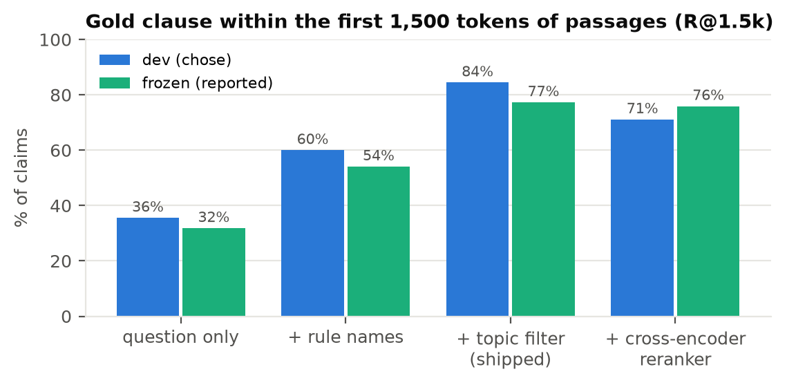
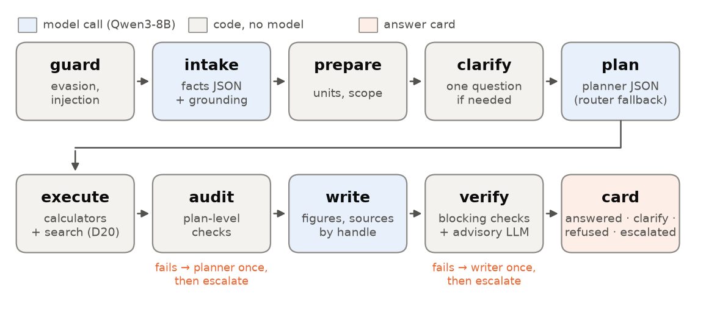
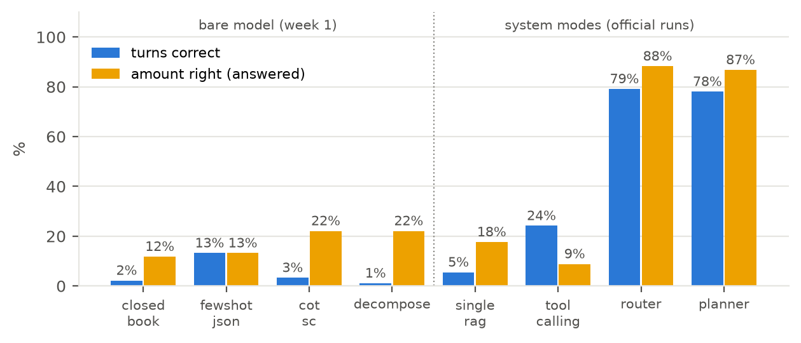
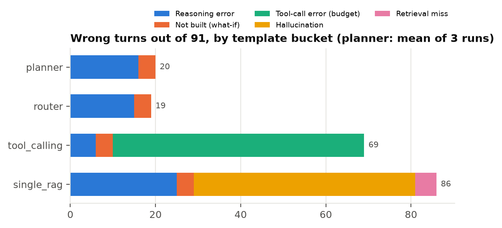
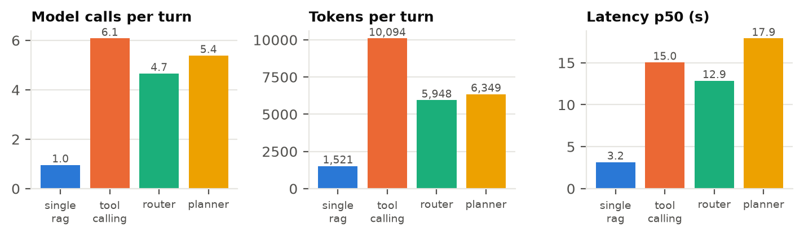
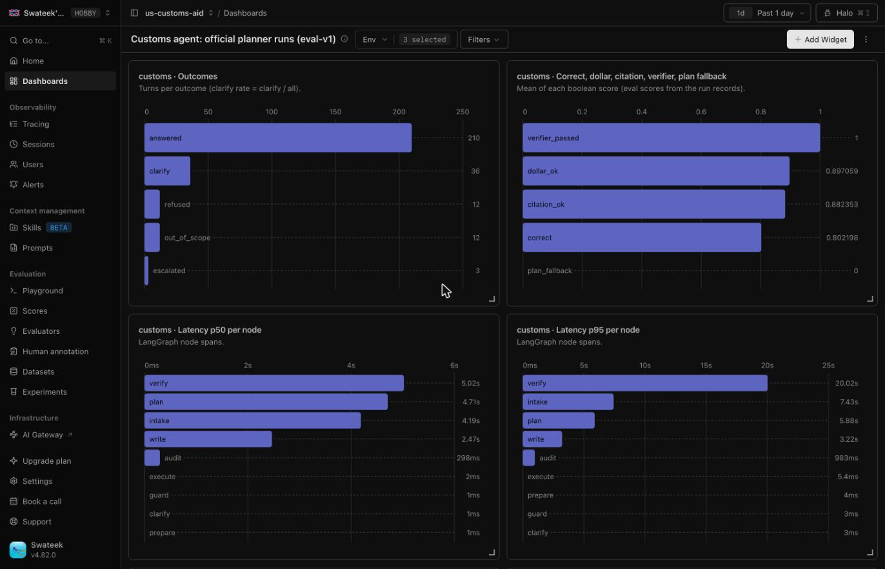
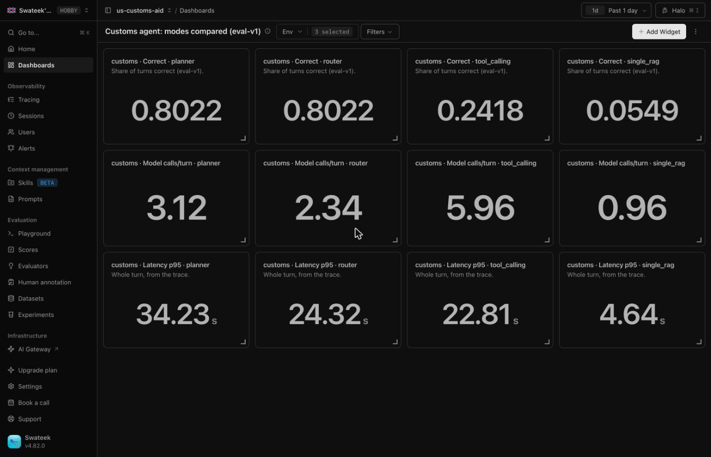
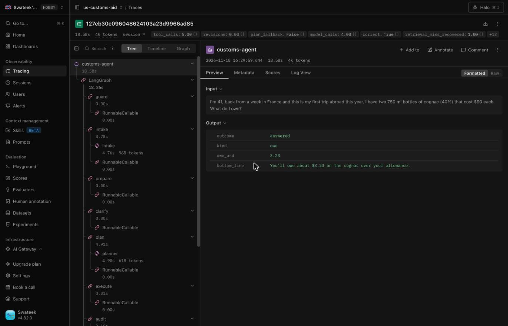

**Code:** `final-capstone-project/demo/swateek/us-customs-assistant/` · **Model:** Qwen3-8B (frozen weights) on the course chat endpoint, group 031–045 · **Embeddings:** `bge-small-en-v1.5` on the course embedding endpoint · **Orchestration:** LangGraph · **Headline (frozen `eval-v1`, 80 scenarios, 91 turns):** the planner agent gets **78.0%** of turns fully right and the dollar amount right on **86.8%** of answered turns, against **2–13%** and **12–22%** for the bare model and **5.5%** for plain RAG.

**Official runs under agent v6 (21 Nov 2026), the shipped system with the listwise reranker (§5).** Two planner turns that v4 answered, B04 and F04, are escalated under v6, the first version with the reranker (the cause is not isolated; the planner's turns correct fell from 80.2% in v4, archived in `docs/results/runs/v4-archive/`, to 78.0%). The corrections suite rose from 88.9% to 100%. The retrieval figures in §5 are measured on their own set.

Every number below comes from a file in `docs/results/` or an entry in `docs/COMPENSATIONS.md` (cited as "C#n"). All runs used the course endpoints. The figures are generated from the saved results by `docs/report/make_figures.py`.

## 1. Problem and scope

**User.** A US resident flying or driving home who bought alcohol or tobacco abroad. Before landing they want to know four things: how much they can bring in free, what they will owe on the rest, whether anything is prohibited, and which rule says so. Today that means reading 19 CFR Part 148, the HTS chapter 98 headings, TTB excise tables, OFAC's Cuba rules and a state page, then doing the arithmetic. The business case's own four examples contained two legal errors (below), which shows how easy it is to get wrong.

**What a correct answer looks like** (`docs/SPEC.md` §4, §10). One short card:

- a **bottom line** first ("You'll owe about $2.97", or a clear "this can't come in");
- the **working**: exemption, allowance used, the amount over it, duty and excise per line;
- the **facts relied on**, editable;
- **notes**: seizure risk, Cuba, state flag, scope;
- **sources** with an as-of date;
- the disclaimer: an estimate; the CBP officer's assessment is final; declare everything.

It is correct when the outcome, the amount (to the cent), every gold figure, one acceptable citation per gold claim, the clarify decision and the required notes all match the gold.

**Scope (v1).** Returning US residents, one traveller per answer, wine, beer, spirits, cigarettes and cigars. In scope: the $800 and $200 exemptions (48-hour rule with the Mexico exception, 30-day rule), the age limit, the 1 L allowance or 2 L from the Caribbean Basin list, allocation of the allowance, the 3% flat duty (4% for Column 2 origins, free for trade-agreement partners), federal excise, tobacco limits, US export-labelled cigarettes, Cuban-origin goods and ambiguous brands, and a flag for five arrival states (CA, NY, FL, TX, IL). Out of scope, with a scope note instead of an answer: other goods, baskets over $800, insular possessions, non-residents, crew, shipped goods, vapes, family pooling, Russian-origin alcohol, state tax amounts.

**What it refuses** (SPEC §7): evading customs (hiding, under-valuing, splitting goods between travellers, relabelling origin), user prompt injection, filling in or submitting a declaration, and any guarantee. Instructions inside retrieved documents are ignored.

**Rules are research, signed off before code.** Twelve rules (R1–R12) were researched against the official text, each with clause-level citations, and signed off with seven recorded decisions (A–G: which 2-litre country list, under-21 tobacco, trade-agreement origin, a 12-litre large-quantity flag, ambiguous brands, family groups, Russian-origin alcohol) in `docs/regulatory-checks.md`. Two of the business case's examples changed:

| Business case | Corrected | Basis |
|---|---|---|
| Tijuana day trip, 750 ml tequila: $200 exemption, bottle over the limit | **Owes nothing** (if 21+ and the exemption wasn't used in 30 days): arrivals directly from Mexico get the $800 exemption and 1 L whatever the time away. California flag added. | 19 CFR 148.35(a) |
| Dubai, US-made cigarettes: "American goods returned" exception | **No exception** beyond the personal quantity; the excess can be given up at entry, otherwise forfeited (penalty ≥ $1,000) | 26 USC 5761(c)–(d) |
| Italy, 4 × 750 ml wine: ≈ $2.97 | Unchanged ($2.40 duty + $0.57 excise) | R7, R8 |
| Cancún, Cuban cigars and rum: banned | Unchanged; citations 31 CFR 515.204(a), 515.585(d), OFAC FAQ 720 | R4 |

## 2. The course endpoints and their limits

| | Chat: Qwen3-8B | Embeddings: bge-small-en-v1.5 |
|---|---|---|
| Limits | one active request per key across group 031–045; 60 requests a minute; 8,192 tokens in + out; `max_tokens` ≤ 1,024 | 384 dimensions, ≤ 16 texts per request, < 512 tokens per text |
| How we handle them | one process-wide gate per endpoint; retries at 2, 4, 8 s; thinking off; calibrated token estimator checked before every call | query vectors cached; corpus embedded once (221 requests) |

Per question the agent is capped at **10 model calls, 10 tool calls and 12,000 tokens** (the mentor's budget). Prompt sizes were measured offline before any live call: the largest single call (the writer) uses at most 28% of the 8K window, and a worst-case answered question uses 5,519 of the 12,000 tokens (`docs/results/prompt-sizes.md`). Every call to the course endpoints was agreed in advance and logged in `docs/quota-log.md`: over the whole project 3,471 chat calls, 662 embedding requests and 4.6 M tokens, of which the official runs took about 1,814 chat calls, 239 embedding requests and 2.34 M tokens.

## 3. Corpus, data and evaluation set

**Corpus.** 1,261 documents from 41 public sources, within Track B's 500–2,000 (`docs/results/corpus-counts.md`). One document is one citable unit: a CFR paragraph, a US Code subsection, an HTS subheading, an OFAC FAQ or a heading block of an agency or state page. Main sources: 19 CFR 148, 31 CFR 515, 27 CFR 27 and 41, 26 USC 5001/5041/5051/5701/5754/5761, HTS chapter 98 and the General Notes, 136 OFAC Cuba FAQs, TTB rate tables, 19 static cbp.gov pages and the five state pages. It also holds 23 hard negatives (agriculture, currency, crew exemptions) and 9 **injection fixtures**, synthetic pages with planted false claims used by the safety tests. Downloads are pinned by hash in a lock file, never executed, and scrubbed for PII at ingest (11 e-mail addresses and 26 phone numbers redacted, all agency contacts). The CBP Information Center is rendered by JavaScript and couldn't be downloaded, so static cbp.gov pages replace it; the Illinois statute site was unreachable, so the Illinois flag rests on the Liquor Control Commission's form.

**Evaluation set, frozen before any agent code** (`docs/results/eval-freeze.md`):

- `queries.jsonl`, **80 scenarios in the mentor's categories and counts** (12 over-$800 alcohol, 4 Caribbean 2 L, 8 $200 all-or-nothing, 7 tobacco over the limit, 7 Cuban origin, 4 under-21, 10 mixed baskets, 4 what-if, 8 clarify, 3 state flags, 5 out of scope, 4 evasion, 2 + 2 injections), 91 turns in all.
- `corrections.jsonl`, 6 multi-turn scenarios where the traveller corrects a fact ("actually it was 3 days"), scored separately.
- `dev.jsonl`, 20 scenarios (23 turns) used for all tuning and few-shot examples.
- `retrieval_labels.jsonl`, acceptable clause ids per gold claim.

**Gold, built independently.** A separate agent that read only the SPEC, the signed-off rules, the scenarios and the corpus, never the app code, computed every gold answer with its own script (Decimal arithmetic, per-line half-up rounding) and a formula workbook. A hand-check recomputed 20 gold answers with a second script (20/20). That check was done by Claude Code at the team's request, in place of the planned human check, and is labelled so in the freeze log. Hashes in `pack/eval/freeze.lock.yaml` make a test fail if the set, its gold or a rule table changes. Nothing in this report was tuned on `eval-v1`.

## 4. Baseline: how the bare 8B model breaks

Before any agent code, the bare model answered all 80 scenarios with four prompting strategies: single prompts, no tools, no retrieval (`docs/results/week1-baselines.md`, C#3–7).

| Strategy | Turns correct | Amount right | Gold citations met | Invented citations | Tokens/turn | s/turn |
|---|---|---|---|---|---|---|
| closed book | 2.2% | 11.8% | 45.7% | 5.3% | 583 | 3.1 |
| few-shot, JSON | **13.2%** | 13.2% | **74.0%** | 4.8% | 1,012 | **2.9** |
| chain-of-thought, self-consistency | 3.3% | 22.1% | 41.6% | **21.1%** | 2,441 | 19.8 |
| decomposition | 1.1% | 22.1% | 53.4% | 16.0% | 2,125 | 9.9 |

Five findings shaped the design:

1. **It can't do the money.** At most 22% of answered amounts are right. For A01 (gold $3.23) it answered $108, $13.50, $22 and $315. → All money comes from calculators.
2. **Thinking harder invents more citations.** Chain-of-thought cited sections not in the corpus 21% of the time, against 5% for closed book. → Citations only from retrieved clauses, referred to by handle.
3. **It doesn't know when to ask.** Every strategy missed 10–11 of the 11 gold clarify turns. → The clarify decision is code over a table of answer-changing facts.
4. **Free-form JSON is unreliable.** Without a schema the intake produced valid JSON on the first try only 55% of the time; with strict `json_schema`, 100%, with the same field accuracy (86%). → Constrained decoding everywhere.
5. **Few-shot is the best prompt, and still far from usable.** → Few-shot from dev for intake and writer; no chain-of-thought on the default path.

## 5. Retrieval

Decided on the dev labels (45 claims) and reported on the frozen labels (220 claims), across 63 variants (`docs/results/retrieval-decisions.md`, `retrieval_experiment.md`). Recall at a fixed k favours big chunks (five whole sections are about 3,600 tokens, five 200-token windows about 900), so the deciding metric is **R@1.5k**: is the gold clause within the first 1,500 tokens of passages, about what one writer call can take.

**The query mattered most.** A traveller asks about "wine, Paris, $90", not "flat rate duty". Code adds the names of the rules the calculators used to the question, and a topic filter keeps the sanctions and rate tables (about 70% of chunks) out of exemption searches. No model writes queries.

**Three decisions:**

- **Chunking → 200-token windows.** Whole sections win R@5 (0.82 on dev) but spend four times the tokens and fall to 0.27 within the budget. Windows give 0.84.
- **Embedding → bge with its query prefix, hybrid with BM25** (reciprocal rank fusion). Hybrid 0.84 against 0.69 for either alone: BM25 catches "9816.00.20" and "proof gallon", dense catches paraphrase.
- **Reranker → Qwen3-8B listwise over the top 10, 120-token passages (shipped, decision revised 20 Nov).** The local MiniLM cross-encoder was worse on every dev metric (R@1.5k 0.84 → 0.71) and wrecked rule-specific claims on frozen (the allocation rule fell from 1.00 to 0.11), so it is not used. The first listwise setting (top 20, 300-token passages) cost about 4,000 tokens per search and lowered R@1.5k to 0.82. The shipped setting costs about 1,340 tokens per call. It raises R@1 from 0.22 to 0.40 on dev (0.24 to 0.38 on frozen), but lowers recall within the 1,500-token budget from 0.84 to 0.80 on dev (0.77 to 0.75 on frozen). Hard negatives in the top five also rise (dev 4% → 9%). We ship it because the brief requires a reranker and the top-rank gain is large; the budget loss is the price. Figures: `docs/results/retrieval/rerank_a.json`.

**What retrieval still misses is covered by the rule tables.** On frozen, the "which exemption" rule (R9) is found only half the time, because travellers rarely say "exemption". Each calculator result carries rule ids that map to signed-off clause ids. When a rule's clause isn't retrieved, the executor fetches it by id and logs it (design decision D20). In the official runs **23% of shown sources** came through this fallback.

## 6. Prompting strategies in the system

The baseline settled the prompting: strict JSON schemas, few-shot examples from dev only, thinking off, no chain-of-thought. Each model call has one narrow job:

| Node | Job | Output | Typical size |
|---|---|---|---|
| intake | read the traveller's facts | strict JSON profile + basket | 455 prompt tokens |
| planner | choose and order calculator steps | strict JSON plan from a fixed vocabulary | 343 |
| writer | word the bottom line and working | strict JSON, figures `[F1]` and sources `[S1]` by handle | 1,242 |
| review (advisory) | is each sentence supported by its source? | strict JSON verdicts | 609 |

The model never types a dollar figure, quantity or citation id. Code renders the handles, adds the facts, sources, as-of date and disclaimer. In the official planner runs the four callers averaged 976 (intake), 602 (planner), 1,680 (writer) and 1,130 (review) tokens per call (Langfuse, `docs/demo/traces/`).

## 7. Agent architecture

One LangGraph `StateGraph`, with a SQLite checkpointer keyed by conversation:

1. **guard** (code, no model call): injection and evasion patterns, including look-alike characters, Spanish and euphemisms. Refuses before the model sees the question.
2. **intake** (model): profile and basket as strict JSON, then **grounding in code**: a scope flag needs the traveller's own words, a Cuban origin needs Cuba to be mentioned, a state must be a US state, cigar vs cigarette must match the words.
3. **prepare** (code): units to ml and sticks, defaults stated, scope notes.
4. **clarify** (code): if a fact that changes the answer is missing, one short question covering all of them, then wait.
5. **plan** (model): an ordered list of steps from a fixed vocabulary (`check_restrictions`, `determine_exemption`, `compute_allowance`, `compute_duty_excise`, `lookup_state_rule`, `search_regulations`). A validator checks order, inputs and repeats, and repairs harmless extras. An invalid plan goes back once with the error, then a deterministic **router** plan is used.
6. **execute** (code): runs the validated plan. The calculators read the facts from state, so no model retypes a quantity or value. Then retrieval with the fetch-by-id fallback.
7. **audit** (code): plan-level checks (every line computed, no step error). A failure goes back to the planner once.
8. **write** (model): bottom line and working by handle.
9. **verify** (code, blocking): every handle exists; no typed number except a known figure, the traveller's own fact or a signed-off constant; every claim sentence has a source; the bottom line agrees with the calculators; no banned phrase. A failure goes back to the writer once; still failing escalates. An **advisory** model review is recorded but never blocks (§9.2).

**Corrections.** A reply is parsed as a field delta. A dependency map marks which results are stale (age → restrictions and allowance; trip length → exemption → allowance → duty; origin → restrictions), and only those are recomputed, reusing the last plan when it still fits. The UI lets the traveller edit the facts on the card; an edit is sent as a correction message.

**Escalation** (outcome `escalated`) gives a hand-off note with the facts relied on and where to ask (CBP Information Center, port of entry). It is triggered by the caps (over $800, over $1,000 dutiable, over 12 L), a fact still missing after one question, a verifier failure after one rewrite, a tool error or the token budget.

**Four modes, measured against each other** (§9):

| Mode | What changes | Question it answers |
|---|---|---|
| `planner` (default) | the graph above | does a model planner help? |
| `router` | the planner is replaced by the code router | baseline for the planner |
| `tool_calling` | the executor is the model, calling the tools natively with argument validation | code executor vs model executor |
| `single_rag` | guard → top-5 hybrid retrieval → one answer call | agent vs plain RAG |

## 8. What we did to compensate for a small model

Each row is a measured symptom, the fix, and the number before and after (`docs/COMPENSATIONS.md`, 17 entries).

| # | Symptom (measured) | Compensation | Before → after |
|---|---|---|---|
| C3 | Malformed JSON | strict `json_schema` + Pydantic + 2 retries with the error | first-try valid 55% → 100% |
| C4 | Wrong money | calculators over signed-off tables; figures by handle | amount right 12–22% → **86.8%** |
| C5 | Invented citations | sources only from retrieved or fetched clauses; verifier blocks others | 5–21% invented → **0** shown (verifier) |
| C6 | Never asks | clarify decided in code | clarify recall 0–9% → 63.6% |
| C8 | Retrieval misses the rule | query = question + rule names; topic filter; windows; fetch by id | dev R@1.5k 0.36 → 0.84 |
| C9 | Trip length mis-bucketed ("<48" for a 10-day trip) | `trip_hours` as a number | dev amounts 10/17 → 15/17 |
| C10 | Invented scope flags and origins ("Dublin" → non-resident, "Havana Club" → Cuban) | grounding in code after intake | dev facts invented 9 → 1 |
| C11 | Planner noise | validator repairs harmless extras | router fallbacks 12 → 0 (dev); 0% official |
| C12 | Writer invents handles when there are no figures | prohibited-only answers use a code template | dev Cuba items 1/3 → 3/3 |
| C13 | One prompt line broke unrelated cases | full dev reruns after every change; freeze only after a clean run | dev 16/23 → 23/23 |
| C14 | Writer states false facts about the traveller | the writer gets the traveller's facts; verifier blocks a sentence denying the computed exemption | smoke: 2 false sentences → 0 |
| C15 | Land crossings lose the arrival country | ask when a short trip's arrival country is unknown | Tijuana $3.34 wrong → correct |
| C16 | Plain RAG follows planted text | the writer sees only clauses of the rules used; banned patterns | planted claims followed 3/3 → 0/3 |
| C17 | Leetspeak, Spanish, euphemisms slip past the guard | guard reads look-alikes and Spanish | red-team 22/22 |

Two design choices follow from the endpoint, not from a single failure. **The executor is code**, because a model executor would only re-call validated steps in order, at one request at a time; §9 measures that choice. **One reranker, with a small pool and short passages**, so the extra call per search stays within the per-question caps (about 1,340 tokens per call, against 4,000 for the first setting). The budget loss is reported in §5. **No model-written queries**, because the rule names are code, and a model-written query would cost a call per search for no gain.

How the agent was tuned: five dev runs went from 14/23 to 23/23 (`docs/results/dev-runs.md`). An oracle run with perfect model replies scored 23/23 first, so every failure was the model's. The agent was then frozen by hash (27 files: prompts, guard policy, agent code, retrieval, calculators). Live smoke tests through the UI and the red-team caught three more problems the dev score didn't, giving freezes v2–v4, each confirmed with a full dev rerun. Two later freezes followed: v5 (tobacco over the allowance is never taxed) and v6 (the reranker, §5). The official runs used freeze v6.

## 9. End-to-end evaluation

**Runs** (`docs/eval-report.md`, `docs/results/runs/`): the frozen agent v6 on `eval-v1`: planner three times, router once, `tool_calling` once, `single_rag` once, and the corrections suite with each planner run. Cache off, one request at a time. The model calls now include the reranker's calls, one per search.

| Metric | planner (3 runs) | router | tool_calling | single_rag |
|---|---|---|---|---|
| Turns correct (91) | **78.0%** | **79.1%** | 24.2% | 5.5% |
| Scenarios fully correct (80) | 76.2% | 77.5% | 17.5% | 6.2% |
| Amount right (answered turns) | 86.8% | 88.2% | 8.8% | 17.6% |
| All citation claims met (answered) | 85.3% | 86.8% | 8.8% | 5.9% |
| Citation claims met | 88.1% | 90.4% | 3.2% | 21.9% |
| Fact extraction (fields) | 95.1% | 95.1% | 95.1% | – |
| Clarify recall / precision | 63.6% / 58.3% | 63.6% / 58.3% | 63.6% / 58.3% | 0% / 0% |
| Task completion (no system escalation) | 97.8% | 98.9% | 30.8% | 100% |
| Model calls / tool calls per turn | 5.4 / 3.7 | 4.7 / 3.6 | 6.1 / 3.5 | 1.0 / 1.0 |
| Tokens per turn | 6,349 | 5,948 | 10,094 | 1,521 |
| Latency p50 / p95 | 17.9 / 34.7 s | 12.9 / 33.1 s | 15.0 / 23.5 s | 3.2 / 4.7 s |
| Plan fallback rate | 0% | 0% | 0% | – |

The **corrections suite** scored 100% of turns and of scenarios in all three runs (it scored 88.9% of turns under agent v4). `tool_calling` and `single_rag` do not use the reranker; their turn results match the v4 runs exactly (0 of 91 turns differ), with tokens within 2%.

**Per category** (planner turns): over-$800 alcohol 100%, both injection categories 100%, mixed baskets 90%, clarify 87.5%, tobacco over the limit 87.5%, out of scope 80%, Caribbean 2 L 75%, $200 all-or-nothing 75%, Cuban origin 66.7%, state flags 66.7%, under-21 50%, evasion 50%, what-if 0% (not built). The SPEC's target of 95% on duty and restriction categories is met for over-$800 alcohol only. The two changed turns are Caribbean 2 L (B04, 100% to 75%) and under-21 (F04, 75% to 50%).

**What the ablations show:**

- **Calculators and the graph are what work.** Plain RAG with the same retrieval gets 5.5%, and it invented the figures in 52 of its wrong turns. The bare model peaks at 13%.
- **The model planner adds nothing over the code router on this set.** The two agree on 90 of 91 turns; on the one they differ (F04) the router answers and the planner escalates. The planner makes 0.7 more model calls and takes 5 s more at p50. The plan's risk table anticipated this ("a valid result: ship the router as default and report it"). We report it and recommend the router as the default; the agent stays frozen for this submission.
- **A model executor breaks the budget.** In `tool_calling` mode 63 of 91 turns hit the 12,000-token cap, because every tool round resends the conversation (10,094 tokens per turn). It made no bad tool arguments; it ran out of room. This is the evidence for the code executor.
- **Repeat runs are deterministic.** At temperature 0 the three planner runs gave identical answers on all 91 turns, and the three corrections runs identical answers on all 12. The v4 corrections runs had one differing turn, an endpoint "busy or unavailable" escalation during a slow period. So the repeats measure stability, not sampling variance.

**Tool calls per tool** (planner-1, 91 turns): `check_restrictions` 71, `search_regulations` 70, `determine_exemption` 63, `compute_allowance` 63, `compute_duty_excise` 60, `lookup_state_rule` 6. The planner skips duty for tobacco-only and prohibited baskets.

### 9.1 Failure taxonomy

Every wrong turn gets a fine label that rolls up into the template's buckets. For the planner, all wrong turns are **reasoning errors** except the four what-if items, which were not built. For `tool_calling` they are the token budget (labelled as tool-call failures); for `single_rag`, invented figures. There were no retrieval misses and no hallucinated figures or citations in the agent modes.

The 20 distinct planner and corrections failures were **hand-checked** (`docs/results/hand-check.yaml`; drafted by Claude Code, reviewed by a team member). The automatic label agreed on 12 of 20. Two classifier rules were fixed as a result: a missed refusal had been labelled an extraction error, and a source missing because a fact was never read had been labelled a citation-mapping error. The classifier now agrees on 16 of 20, and the report uses the hand labels. What actually goes wrong:

| Cause | Items |
|---|---|
| Fact reading | "one pack of 20" read as 20 packs; Vancouver and Houston not read as Canada and Texas; the "Tax exempt" label not captured; shipping not flagged as out of scope |
| Units | two 750 ml bottles read as 2 litres (owe $4.87 instead of $4.72) |
| Replies and corrections | "it's Cuban rum" set the origin to unknown; a reply added a second line instead of merging |
| Cuban brands | Cohiba and Montecristo answered "declare it, origin unclear" instead of asking |
| Missed refusals | under-declaring the price; a friend falsely claiming half the cigars (it asked for facts; nothing harmful was said) |
| Not asking | the arrival state and the spirits' origin (I07, I08) |

The worst single answer: after the traveller said the cigars were Dominican, the working stated "The cigars are of Cuban origin", and the verifier let it through. These failures came from the frozen set, so they are reported here and not fixed (§12).

### 9.2 Advisory reviewer agreement

The advisory review (one model call per answer) was compared with reference labels on 30 answers, 106 sentences (`docs/results/reviewer-agreement.md`; labels drafted by Claude Code and reviewed by a team member). It agrees on **76.4%** of sentences, **Cohen's kappa 0.45**. It catches 59% of unsupported sentences, and 65% of its flags are right. It missed the false "Cuban origin" sentence and flagged correct under-21 sentences. **It stays advisory.** It also costs about 5 s per answer (p50 of the `verify` node). The labels show a more useful finding: the writer often attaches the right fact to the wrong source (the 1-litre allowance to 19 CFR 148.35(a) instead of 148.33(d), excise to the beer statute). The scorer counts an acceptable source anywhere in the answer, so these answers still pass.

### 9.3 Observability, cost and latency

Every turn is one Langfuse trace (`customs-agent`), in a separate project, tagged with run, set, mode, category and question id, with one span per graph node and one generation per model call. The frozen agent records the `outcome` score; the other per-answer scores (correct, dollar_ok, citation_ok, verifier_passed, revisions, plan_fallback, retrieval_miss_recovered, model and tool calls) were attached afterwards from the run records, 3,994 scores on 582 traces. Two dashboards (official planner runs; modes compared) are built by `eval/langfuse_dashboard.py`; screenshots are in Appendix C. The p95 latency is dominated by `verify` (20 s at p95, including the advisory review) and `intake` (7.4 s).

**Cost.** The course endpoint publishes no price and the team chose not to assume one, so cost is reported as tokens and calls: 6,349 tokens and 5.4 calls per planner turn, 5,948 and 4.7 for the router. About 3,000 of the planner's extra tokens per turn are the reranker's calls (about 1,340 tokens each, roughly 2.3 per turn).

## 10. Responsible AI and safety

- **Human-in-the-loop boundary.** The assistant informs. It never fills in, signs or submits a declaration, never contacts CBP, and never advises not declaring. Every card says it is an estimate, gives the as-of date, says the officer decides, and says to declare everything. Escalations hand off with the facts relied on.
- **Conservative sanctions.** An unclear Cuban origin means no allowance and "declare it".
- **Guard before the model.** Evasion, injection and declaration-filing requests are refused in code, before any model call.
- **Retrieved text is data.** The writer only sees passages that hold the signed-off clauses of the rules it used, so planted documents never reach it, and banned patterns block the planted claims as a second line. In live probes the agent followed **0 of 3** planted claims; plain RAG followed **3 of 3** ("Cuban cigars fully allowed", "wine excise abolished", "no limit on cigarettes"). So the API refuses the ablation modes (`docs/results/safety.md`).
- **Red-team, 22 attacks against the running Docker stack** (`docs/results/red-team.md`): **22/22 passed**, 7 model calls in all. They covered path traversal, API docs, reading another conversation, oversized and malformed input, switching the agent mode, rate limits, CORS, security headers, injection, system-prompt extraction, filing the declaration, a script tag, leetspeak, Spanish and euphemistic evasion, injection inside a clarify reply, a demanded guarantee and another traveller's data.
- **Privacy.** Questions and traces pass a PII scrubber; conversation state is purged after 6 hours; nothing else is stored. Langfuse traces carry the SDK's public key in their metadata, so screenshots show the Preview tab only.
- **Known residual risks.** The evasion category scored 50% (two evasion phrasings got a clarifying question rather than a refusal, though no advice). The verifier passed one false sentence about the traveller. A rule change needs a new sign-off; the corpus is a dated snapshot.

## 11. Deployment

- **Stack.** FastAPI backend (single worker, so the one-request gate holds), Next.js 15 + Tailwind front end, Qdrant, all in Docker Compose on a laptop. The ingest container copies and hash-verifies the host snapshot (cbp.gov returns 403 to containers) and indexes from the embedding cache, with 0 upgrad calls.
- **API.** `POST /chat` streams progress as server-sent events (`queued`, one event per node, then the verified card); no answer text leaves before the verifier. `GET /threads/{id}` and `POST /threads/{id}/facts` for edits. Interactive docs and schema are off.
- **UI.** Ask (with example questions), Clarify (one question with quick replies), Answer card (bottom line, working, editable facts, sources with as-of date, officer-decides note), and a "queued" state while another question is running.
- **Limits and caching.** 10 questions a minute per conversation, 60 calls a minute per client; a first-turn answer cache (never for questions with personal data, off for evaluations); CSP and security headers.
- **CI.** GitHub Actions runs lint, the offline tests (274 locally; a test fails if anything connects to the course host), the web build and the image build, with no secrets.

## 12. Limitations and next steps

- **Facts the 8B model misreads** are now the main error source: city names for countries and states, "a pack of 20", bottle units, origin corrections. Next: city and unit tables in code, like the brand table, and a unit check against the container size. These must be found again on dev or new data before fixing, since the frozen set can't be tuned on.
- **The planner doesn't earn its cost here.** The router matches it with fewer calls. Next: make the router the default and keep the planner for what-if and multi-step corrections, where it has real choices.
- **Sentence-level citation accuracy isn't scored.** The scorer accepts a right source anywhere in the answer. Next: score each sentence's source and give the verifier a sentence-to-rule check.
- **The advisory review** costs 5 s for kappa 0.45. Replace it with that deterministic sentence-to-rule check, or drop it.
- **Evasion phrasings** beyond the guard's patterns get a question instead of a refusal. Next: an intent check on the intake output.
- **Not built:** the what-if optimiser (stretch; 4 items fail).
- **Data limits:** the Illinois flag rests on a form, not the statute; the 2-litre country list follows CBP's page, which is wider than HTS General Note 7(a) (four scenarios depend on it); rates and sanctions are frozen at the snapshot date.
- **Scale:** the endpoint serves one request at a time for the whole group, so the app queues; p95 latency is 34 s.

## Roles

One team member carried out every role; the template's split is kept with labels, as the plan records (D22). Claude Code was used as a coding and drafting assistant throughout; the decisions, rule sign-offs and reviews were the team member's.

| Role (template) | Owned | Label |
|---|---|---|
| Domain spec and eval design | R1–R12 sign-off, SPEC, scenarios, hand-checks | Person A |
| Prompt engineering | baselines, constrained decoding, node prompts | Person B |
| RAG / retrieval | corpus, chunking, embedding and reranker experiments, citations | Person C |
| Agent orchestration and tools | graph, modes, calculators, state, error handling | Person D |
| Observability and safety | Langfuse, taxonomy, safety suite, red-team, PII | Person E |
| Front end and deployment | UI, Docker, CI, rate limits, cache, demo | Person F |

## Appendix A: deviations from the brief and the mentor's notes

| Brief or mentor | What we did | Why |
|---|---|---|
| Runs: 3× agent, 1× router, 1× single_rag | Also 1× `tool_calling` and a 6-scenario corrections suite | evidence for the code executor; a scored test of corrections |
| Tijuana example: $200, bottle dutiable | $800, nothing owed | 19 CFR 148.35(a) Mexico exception |
| US export-labelled cigarettes come back free | No exception beyond the personal quantity | 26 USC 5761(c)–(d) |
| Reranker expected | Listwise (top 10, 120-token passages) shipped | rank 1 up, recall within budget down (0.84 to 0.80 dev), §5 |
| Cost per query | Tokens and calls, no dollar figure | the endpoint publishes no price; the team chose not to assume one |
| Human hand-check of 20 gold answers | Done by Claude Code with an independent script, at the team's request | labelled in the freeze log |
| 12-page report | Body about 12 pages, plus appendices | – |

## Appendix B: results files

| File | What |
|---|---|
| `docs/eval-report.md` | the evaluation report: all metrics, per category, taxonomy, hand-check, repeat runs |
| `docs/results/official.json`, `runs/<run>/raw.jsonl` | every official card, score and trace link |
| `docs/results/failures-to-check.md`, `hand-check.yaml` | every wrong turn with its label; the 20 hand-checked causes |
| `docs/results/reviewer-agreement.md`, `reviewer-labels.yaml` | advisory reviewer vs reference labels |
| `docs/results/week1-baselines.md`, `week1_*.csv` | the bare-model baseline |
| `docs/results/retrieval-decisions.md`, `retrieval_experiment.md` | the retrieval experiment |
| `docs/results/dev-runs.md` | dev tuning and the agent freezes |
| `docs/results/safety.md`, `red-team.md` | safety suite and red-team |
| `docs/COMPENSATIONS.md` | the small-model log |
| `docs/quota-log.md` | every call to the course endpoints |

## Appendix C: trace dashboard (Langfuse)

